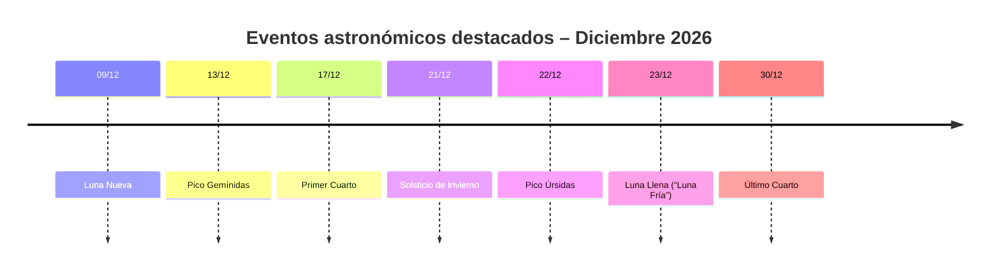

# Resumen Ejecutivo  
Diciembre 2026 es un mes cargado de fenómenos astronómicos clave: el **solsticio de invierno** el 21 de diciembre (20:50 UTC) marca el día más corto en el hemisferio Norte; las lluvias de meteoros **Geminidas** (pico 13–14 dic.) y **Úrsidas** (21–22 dic.) prometen cielos espectaculares; y la **“Luna Fría”** llena del 23 al 24 de diciembre será además la Luna llena más cercana de la década. Se alinea un desfile planetario en la segunda mitad de mes (Marte, Júpiter, Saturno, incluso Venus en el alba). No hay eclipses en diciembre 2026.  

Destacamos que la mejor visibilidad de estos eventos será desde ubicaciones oscuras y alejadas de la contaminación lumínica: en España y Latinoamérica, varios sitios certificados *Starlight* y *Dark Sky* ofrecen condiciones óptimas (ver sección de **Zonas certificadas**). Para cada fenómeno hemos incluido horario en UTC (con ejemplos en CET/CEST y UTC–5), cobertura hemisférica y consejos prácticos de astrofotografía y astroturismo. A continuación se presenta el calendario completo de eventos (figura cronograma).

## Calendario Astronómico (Diciembre 2026)  

| Fecha (UTC)        | Evento                            | Detalles y visibilidad                                                                                      |
|--------------------|-----------------------------------|-------------------------------------------------------------------------------------------------------------|
| **9 Dic, 00:51**   | Luna Nueva                        | Ocurre a las 00:51 UTC. Cielo muy oscuro (Luna ausente). *Visibilidad:* todo el mundo. Ideal para galaxias y nebulosas (Orion, Pléyades) . Lugares Starlight/DarkSky (ej. Montsec, La Palma, Mont-Mégantic) ofrecen panoramas despejados.|
| **13–14 Dic**      | Pico Gemínidas (trazadoras)       | Lluvia mayor del mes. Pico alrededor de la madrugada del 14 (nt. local), tasas ZHR≈100–150/h en condiciones óptimas. Radiant en *Géminis* (cerca de Cástor). Mejores horas: tras la medianoche. Visible en ambos hemisferios (perceptible especialmente en Norte); requiere cielo muy oscuro. Sitios Starlight (ej. Montsec, La Palma, Teide) o DarkSky (Mont-Mégantic, Aoraki Mackenzie) brindan panoramas ideales. |
| **17 Dic**         | Primer Cuarto de Luna             | 17:42 UTC (aprox. 05:42 UTC). Luna al 50 % iluminada. Sale alrededor de medianoche y se pone al mediodía siguiente; ilumina el cielo matinal de madrugada. *Visibilidad:* ambos hemisferios. Usar la Luna creciente para planificar sesiones de paisaje con iluminación sutil. |
| **21 Dic, 20:50**  | Solsticio (invierno Norte)        | Solsticio boreal a las 20:50 UTC. Comienza el invierno astronómico en el Hemisferio Norte y el verano en el Sur. En el Norte las noches son más largas (favorables para observación), en el Sur ocurre lo contrario. Alcanza latitudes altas, alentando las auroras boreales en el Norte (ver Auroras) y ocasionalmente australes en latitudes polares del Sur. |
| **22–23 Dic**      | Pico Úrsidas (trazadoras)         | Lluvia secundaria débil. Pico en la madrugada del 23 (nts. 21–22 dic), ZHR ~5–10/h. Radiant en *Ursa Minor* (Osa Menor, muy septentrional); es visible solo desde latitudes altas del Norte (casualmente con Luna creciente muy brillante ~99 %). Las condiciones son difíciles con Luna cercana al plenilunio, sólo los trazos más brillantes son visibles. Hay que observar después de medianoche en el hemisferio Norte (en Sur no se ve). Sitios oscurecidos mejoran la vista, pero la Luna llena opacará la mayoría. |
| **23 Dic, 17:28**  | Luna Llena (“Luna Fría”/Superluna) | Luna llena a las 01:28 UTC del 24 Dic (local 23 Dic 17:28 CET). Iluminación 100 %. Es una *“superluna”* muy cercana (~358,000 km), la más próxima en la década. Sale al atardecer (~6–7 h local) y se pone al amanecer (~16–17 h UTC). Produce gran brillo nocturno; fotográficamente sirve para escenas de luna en el horizonte al amanecer/atardecer (ej. +14% diámetro aparente). Visible globalmente; en sitios oscuros destaca la silueta lunar espectacular.  |
| **27 Dic**         | Conjunción Luna–Júpiter           | Luna al 5° de Júpiter en la mañana del 27 de diciembre. Magnitud Júpiter ≈–2.2 (muy brillante), elongación ~98°W (se ve antes del alba). *Visibilidad:* predominante hemisferio Norte y medios sureños; útil observar en contra del resplandor del alba. Desde sitios sin contaminación (p.ej. Starlight: Fuerteventura, Teide) la conjunción es hermosa. |
| **28 Dic**         | Conjunción Luna–Marte            | Luna al 6° de Marte el 28 Dic. Marte magnitud +0.8 (brillante rojizo), elongación ~117°W (muy visible en la madrugada). *Visibilidad:* Sur y Norte globalmente. Encuadre fotogénico en el cielo matutino. Lugares oscuros (DarkSky, ej. Aoraki) maximizan la claridad. |
| **Fechas variadas**| Otras conjunciones menores      | *5 Dic:* Luna–Venus (alba); *7 Dic:* Luna–Mercurio (alba); *18 Dic:* Luna–Saturno (noche). Visibilidades locales: Venus (–4.9 mag) y Mercurio (~0.0 mag) en el alba Norte/Sur; Saturno (+0.6 mag) en cielo crepuscular oeste. Magnitudes y elongaciones provienen de pronósticos SWL. |

## Fases Lunares (dic. 2026)  

| Fase          | Fecha UTC             | Hora (UTC)       | Iluminación | Ej. hora local CET (UTC+1) |
|---------------|-----------------------|------------------|-------------|----------------------------|
| Luna Nueva    | 9 Dic 2026            | 00:51 UTC  | 0 %        | 9 Dic 01:51 CET             |
| 1er Cuarto    | 17 Dic 2026           | 05:42 UTC | ~50 %      | 17 Dic 06:42 CET            |
| Luna Llena    | 24 Dic 2026           | 01:28 UTC | 100 %      | 24 Dic 02:28 CET            |
| Último Cuarto | 30 Dic 2026           | 18:59 UTC | ~50 %      | 30 Dic 19:59 CET            |

*Obs.:* Las horas de salida/puesta dependen de la ubicación. En latitudes templadas (~45°N) por ejemplo, la Luna nueva no sale; la Luna llena del 23 Dic sale al anochecer (≈18 h local) y se pone al amanecer (≈06 h del 24 Dic). La Luna llena de diciembre (la “Luna Fría”) sale al atardecer y produce un resplandor brillante en el cielo nocturno.

## Lluvias de Meteoros

- **Geminidas (π-Gemínidas):** Activa del 4 al 17 de dic, *pico*: 13–14 Dic (máximo 13 Dic, 23:00–03:00 UTC). ZHR ≈100–150 en cielos oscuros. Radiant en Géminis (RA ~07h, dec +32°). Visible en ambos hemisferios, mejor en Norte por cenit alto. Mejor hora tras medianoche. Observa desde **lugares oscuros certificados** (Starlight/DarkSky) para minimizar contaminación lumínica. Ej.: Parque Montsec (ESP), Aoraki Mackenzie (NZ), Mont-Mégantic (CAN) tienen cielos excelentes.
- **Úrsidas:** Activa 17–26 dic, *pico*: 22 Dic (~00:00–04:00 UTC). ZHR baja (~5–10/​h), ocasionales brotes hasta 25/h. Radiant en Ursa Minor (estrella Polaris cercana). Visible *solo en hemisferio Norte*. Mejor tras medianoche; la Luna llena casi impide la vista de muchos meteoros, solo los más brillantes aparecen. Para chance de verlos, ir a máximas latitudes del Norte (Escandinavia, Canadá). La Luna al 89–98% dificultará la observación.  
- **Otras lluvias menores:** Diciembre tiene lluvias débiles: φ-Casiopeidas (6 Dic), Monocerótidas (9 Dic), Sigma-Hídridas (12 Dic), Comae Berenícidas (17 Dic) y Leonis Minoridas (21 Dic), todas con ZHR ≪20. Se suelen mencionar en calendarios, pero su aporte es muy modesto comparado con Gemínidas/Úrsidas. Se observan mejor bajo cielo nuevo (p.ej. φ-Casiopeidas el 8 Dic luna casi nueva).

| Lluvia        | Radiant (Constelación) | Pico (UTC)              | ZHR (máx) | Mejores condiciones      |
|---------------|------------------------|-------------------------|-----------|--------------------------|
| Gemínidas     | Géminis                | 13–14 Dic (~00–03 UTC)  | ~100–150  | Noche despejada, hemisferio Norte (pero también Sur), Luna nueva cercana. |
| Úrsidas       | Osa Menor (cerca Polaris) | 22 Dic (00–04 UTC)  | ~5–10  | Latitudes boreales, Luna llena (difícil). Visibles sólo Norte. |
| Comae Berenícidas (débil) | Coma Berenices | 16–17 Dic                 | <10      | Cielo oscuro (Noche Luna nueva).      |
| Otras menores (Monocerótidas, φ-Casiopeidas, etc.) | Varias | 5–21 Dic                  | <5       | Condiciones ideales (Luna nueva, cielo seco). |

## Conjunciones y Fenómenos Planetarios

Durante diciembre se producen varias conjunciones Luna-planetas y alineaciones de planetas:

- **Desfile planetario (finales de mes):** Entre el 27 y 30 Dic, Marte, Júpiter, Urano, Saturno forman un arco en el cielo vespertino. Marte (mag.≈+0.8) y Júpiter (≈–2.2) dominan la escena oriental tras las 22 h (UTC). Saturno (+0.6) se sitúa al suroeste. En la madrugada siguiente se unen también Venus (-4.9) y Mercurio (≈0.0) hacia el este. Este evento puede verse mejor desde latitudes altas (Aurora Boreal, no aplicable, sino cielo claro sin Luna). La alineación completa es ideal para fotografía gran angular. Las elongaciones (todos ≳90°) y magnitudes cercanas a condiciones óptimas. 

- **Conjunciones Luna–Planetas:**  
  - *Luna–Venus*: 5 Dic (AM).  
  - *Luna–Mercurio*: 7 Dic (AM).  
  - *Luna–Saturno*: 18 Dic (22:34 UTC conjunción Luna–Saturno, 26° de separ.). Saturno (+0.6 mag, elong. 124°E) visible en cielo crepuscular nocturno.  
  - *Luna–Júpiter*: 27 Dic (madrugada). Venus se ha ido; Luna (casi llena) se acerca a Júpiter en Sagitario. Júpiter mag ≈–2.2, elong. ~98°W (visible al alba).  
  - *Luna–Marte*: 28 Dic (madrugada). Marte se ilumina en el este, Luna junto a él.  

Magnitudes y elongaciones planetarias se estiman de SWL. Estas conjunciones son fácilmente observables a ojo o con binoculares desde cualquier latitud diurna pertinente. En regiones desprovistas de contaminación (p.ej. reservas Starlight como Tenerife/Teide o DarkSky como NamibRand) el fenómeno se aprecia con nitidez excepcional. 

## Eclipses en Dic. 2026  

No hay eclipses solares ni lunares en diciembre de 2026. La última fase lunar completa ocurre con la superluna del 23-24 dic (no eclipsada).  

## Pases de Satélites y Lanzamientos Espaciales

- **Satélites brillantes:** La Estación Espacial Internacional (ISS) es visible en varias tardes/noches con magnitudes hasta –3. Se recomienda consultar predicciones en sitios como *Heavens-Above* o apps (no hay un evento único mensual). Con la era post-Iridium, los destellos brillantes son menos predecibles. Sin embargo, réplicas de Starlink (mag ~+1 a –2) aparecen en trenes frecuentes, especialmente tras el crepúsculo. 

- **Lanzamientos programados (orbitales):** Según la lista actualizada de lanzamientos:  
  - *2 Dic*: **SpaceX NROL-132** (EE. UU., Falcon 9, órbita baja, satélite de reconocimiento).  
  - *4 Dic*: **SpaceX CHORUS C** (E. Canadá, Falcon 9, 2 satélites SAR terrestre).  
  - *10 Dic*: **CASC SatNet LEO** (China, CZ-12, constelación de telecomunicaciones).  
  - *18 Dic*: **Ariane 6 (Vega-C)** MetOp-SG B1 (Europa, satélite meteorológico NOAA/EUMETSAT).  
  - *30 Dic*: **SpaceX** Globalstar 2R, Telesat Lightspeed 1, y un **Vulcan** NROL-64 (USA). (Las fechas, horas y cohetes pueden variar).  

Estos lanzamientos son visibles desde sus zonas de impacto: la mayoría despega desde Cabo Cañaveral o Vandenberg (horizonte sureste del Atlántico oeste) a horas fijas (ej. CHORUS: 4 dic 07:55 EST). Se aconseja consultar fuentes oficiales (SpaceX, Arianespace) días previos, ya que la hora UTC puede cambiar. En turismo astronómico, un lanzamiento en vivo suele implicar cierres en parques; por ello, verificar rutas y permisos locales es clave.

## Zonas certificadas *Starlight* / *Dark Sky*  

Para cada evento, un cielo oscuro es crucial. A continuación, algunos sitios recomendados certificados Starlight o Dark Sky, con coordenadas y categoría:

| Sitio                        | País       | Coordenadas (lat,lon)  | Certificación         | Fuente             |
|------------------------------|------------|-----------------------|-----------------------|--------------------|
| **Parque Astronómico Montsec** | España     | 41.850°N, 0.650°E    | Starlight Reserve (*) | Parc Astronòmic Montsec |
| **Parque Nacional Teide (Islas Canarias)** | España | 28.272°N, 16.642°W | Reserva Starlight | Turismo España    |
| **Parque Nacional de La Palma** | España    | 28.682°N, 17.881°W   | Reserva Starlight | Turismo España    |
| **Mont-Mégantic (Parque Québec)** | Canadá    | 45.456°N, 71.153°W   | Dark Sky Reserve      | OMM (Univ. Montréal) |
| **Aoraki Mackenzie**        | Nueva Zelanda | 43.984°S, 170.465°E  | Int’l Dark Sky Reserve  | UNESCO Astr. Heritage |
| **NamibRand Nature Reserve** | Namibia    | 24.766°S, 15.928°E   | Dark Sky Reserve    | *IDA (fuente en inglés)* |
| **Península de Stubai**      | Austria    | 47.085°N, 11.187°E   | Dark Sky Park (IDA) | *IDA*              |
| **Parque Nacional Torres del Paine** | Chile  | 51.050°S, 72.000°W   | Dark Sky Sanctuary  | *IDA*              |
| *(*) Montsec es Starlight Tourist Destination y Reserve; existen otros sitios Starlight notables en España (e.g., Fuerteventura, Sierra de Albarracín).*

*Certificaciones:* “Starlight” se otorga a parques y destinos turísticos con cielos excepcionales. “Dark Sky” (IDA) identifica parques/reservas con contaminación lumínica mínima. Todos los sitios anteriores cuentan con documentación oficial. Desde estos lugares el horizonte nocturno es muy oscuro, maximizando la visibilidad de meteoros, nebulosas y auroras.

## Auroras Boreales y Australes  

**Temporada:** De septiembre a abril los polos experimentan largas noches propicias para auroras. Diciembre ofrece noches largas en el Norte (favorables para **Aurora Boreal**); en el Sur es verano con noches cortas, pero se pueden avistar ocasionalmente auroras australes desde latitudes extremas de hemisferio Sur (Antártida, Tasmania, Patagonia).  

**Índices Kp esperados:** En el pico solar de 2025–26 hay más tormentas geomagnéticas: NOAA estima eventos con Kp ≳5 este invierno (por ejemplo, a fines de noviembre se pronosticó Kp=5). Como referencia, auroras intensas (Kp≥5) permiten verlas en ~55–60°N (ej. Reino Unido, Norte de EEUU), y Kp≥7 las extiende hasta ~50°N. En el Hemisferio Sur, latitudes ≳50°S (Tierra del Fuego, Isla Sur de NZ) son más propensas bajo tormentas geomagnéticas.  

**Zonas recomendadas:**  
- *Boreal (Norte):* Escandinavia ártica (Tromsø 69°N, Kiruna 68°N, Fairbanks 64°N), Norte de Canadá (Yellowknife 62°N) o Siberia (Murmansk 68°N). Estas latitudes, alejadas de luces de ciudades, garantizan excelentes vistas. El Portal de Nat. Geogr. destaca Islandia, Groenlandia y Alaska como destinos top.  
- *Austral (Sur):* Península Antártica, Tasmania (Hobart 42°S; en dec los días son largos pero auroras fuertes pueden bajar de latitud), Isla Sur de NZ (Queenstown 45°S, Lake Tekapo 44°S) y sur de Chile/Argentina (Punta Arenas 53°S). Estas regiones remotas requieren buena planificación logística.  

**Herramientas de seguimiento:** Se aconseja vigilar pronósticos en tiempo real: el NOAA SWPC ofrece mapas de visibilidad en https://www.spaceweather.gov/aurora, incluyendo índices Kp actuales y predicción 3 días. Otras fuentes útiles: SpaceWeatherLive, aplicaciones móviles (p.ej. *My Aurora Forecast*, *AuroraWatch*). El “Aurora Dashboard” de NOAA muestra dónde podría ser visible la aurora cada noche. En astroturismo, combinar información de estas fuentes con webcams de latitudes altas maximiza las probabilidades de observar una aurora. 

## Recomendaciones Prácticas

- **Astrofotografía:** Use cámara DSLR/mirrorless en modo manual. Montura firme (trípode sólido). Lente gran angular rápida (f/2.8 o menor) para panoramas estelares. Ajustes típicos: ISO 1600–3200, exposición 15–30 s (para un sensor full-frame; si no, ajuste a evita trazas largas, NPF rule). Dispare en RAW. Use disparador remoto o temporizador para evitar vibraciones. Para nebulosas y Vía Láctea: apunte durante fases de Luna baja (o nueva); enfoque al infinito usando enfoque manual en una estrella brillante. Filtros antiniebla (dew heater), bloqueadores infrarrojos o filtros de contaminación lumínica pueden ayudar en cielos con algo de polución.  
  - *Consejo:* en meteoros, use disparos continuos de 20–30 s mientras cubre el cielo con lente angular. En conjunciones lunares/planetarias, experimente con focales más largas (~100–200 mm) y bracketing de exposiciones.  
- **Astroturismo:** Planifique la visita según la fase lunar (noches sin Luna prolongan la observación) y condiciones meteorológicas (aire seco, cielos despejados). Llegue antes del anochecer para instalarse (las reservas naturales pueden cerrar puertas al público). En invierno (hemisferio Norte) prevenga hipotermia: lleve ropa abrigada (capas térmicas, guantes, gorro) y linternas de luz roja. Informe a guardabosques o autoridades locales su itinerario nocturno; en parques remotos a veces se requiere permiso para permanecer fuera del horario. Tenga en cuenta fauna silvestre (osos, lobos, etc.) y caminos helados; evite rutas no señalizadas. Considere alojarse dentro de la reserva o en los alrededores para maximizar horas de observación (algunos alojamientos en sitios Starlight organizan safaris de estrellas). Para la fotografía móvil, aplicaciones como Photopills o The Photographer’s Ephemeris ayudan a planificar encuadres con la Luna y Planetas. Siempre revise reglamentos locales: p.ej., en parques de EE. UU. los vehículos pueden necesitar permisos especiales para permanecer tras el anochecer.

## Resumen de Sitios Starlight/Dark Sky  

| Sitio                         | País       | Latitud  | Longitud   | Certificación                    |
|-------------------------------|------------|----------|------------|----------------------------------|
| Montsec (Parc Astronòmic)     | España     | 41.85°N  | 0.65°E     | Starlight Reserve (*) |
| Teide (Parque Nacional)       | España     | 28.27°N  | 16.64°W    | Reserva Starlight    |
| La Palma (Parque Nacional)    | España     | 28.68°N  | 17.88°W    | Reserva Starlight    |
| Fuerteventura (Biosfera Starlight) | España | 28.39°N  | 14.06°W    | Reserva Starlight (Biosfera)      |
| Mont-Mégantic (PN Mont-Mégantic) | Canadá  | 45.4558°N| –71.1525°W | Dark Sky Reserve    |
| Aoraki Mackenzie              | NZ         | 43.984°S | 170.465°E | Int’l Dark Sky Reserve|
| NamibRand (Namibia)           | Namibia    | 24.766°S | 15.928°E  | Dark Sky Reserve (IDA)           |
| Fairview (Utah, EE. UU.)      | EE. UU.    | 39.341°N | 114.092°W | Starlight Protected Area        |
| Mont Mégantic (frontera CAN/FRA) | Canadá/Francia | 45.46°N | –71.15°W  | Dark Sky Reserve (IDA)|

(*) *Montsec figura como “Starlight Tourist Destination” y cuenta con áreas certificadas como Reserva Starlight. Otros sitios denominados “Lights Parks” o “Oasis Starlight” existen globalmente.*

Estos puntos han sido verificados por organizaciones oficiales (Starlight Foundation, IDA). Sus cielos ofrecen niveles de oscuridad excepcional (mínima contaminación lumínica). Desde ellos, las lluvias de meteoros se observan con mejores tasas efectivas, las nebulosas se aprecian con menos ruido lumínico, y las auroras (si aparecen) suelen ser más intensas.  

**Fuentes:** Calendarios astronómicos oficiales y especializados; sitios Starlight y Dark Sky registrados por sus fundaciones; NOAA/SpaceWeather (aurora); guías de astrofotografía y turismo general.

